


<code><a href="https://github.com/steepsalvadorman/steepsalvadorman/blob/main/README.md">EN</a> · <b>ES</b></code>

**Construyo software confiable para operaciones industriales, procesos de laboratorio y productos en tiempo real.**

`Lima, Perú · Abierto a oportunidades en backend, plataformas y tecnología aplicada`

 


QA Automation Engineer y programador en **HR Ingenieros Asociados**, consultora minera, donde construyo pruebas automatizadas con Playwright, Java y TypeScript y lidero la planificación y la arquitectura del equipo. Antes, en **Marcobre S.A.C.** y **Compañía Minera Condestable**, desarrollé software para entornos mineros e industriales. Mi trabajo abarca **microservicios con Spring Boot**, aplicaciones en **Angular**, despliegues sobre **Azure** y sistemas que sostienen operaciones trazables del día a día.

Combino desarrollo de aplicaciones empresariales con experiencia práctica en **SampleManager LIMS**, captura de datos industriales, programación de sistemas y machine learning aplicado. Me interesan especialmente los problemas donde el software interactúa con procesos reales, dispositivos o datos científicos.

 


- Diseño y desarrollo de servicios backend y aplicaciones web para casos de uso mineros e industriales.
- Flujos de información de laboratorio con **SampleManager LIMS**: registro y trazabilidad de muestras, procesos analíticos, ingreso, validación y reporte de resultados.
- Despliegue y entrega en la nube con **Azure**, **Docker**, bases de datos relacionales y componentes orientados a eventos.
- Integraciones industriales en **Rust**, incluyendo comunicación con balanzas y captura de datos operativos.
- Sistemas en tiempo real con OAuth 2.0, webhooks, WebSockets, PostgreSQL y despliegues contenerizados.
- Experimentación en visión por computadora con **Python**, MediaPipe, OpenCV, TensorFlow y PyTorch.

 


<a href="https://github.com/steepsalvadorman/DaiBotkick"></a>
<a href="https://github.com/steepsalvadorman/MiningSmartScale"></a>
<a href="https://github.com/steepsalvadorman/newposture_detector"></a>
<a href="https://github.com/steepsalvadorman/microservices_java"></a>
<a href="https://github.com/steepsalvadorman/spring-security-complete"></a>
<a href="https://github.com/steepsalvadorman/Portfolio"></a>
<a href="https://github.com/steepsalvadorman/steepskynetdotfiles"></a>
<a href="https://github.com/steepsalvadorman?tab=repositories"></a>

<code>Versión en texto</code>

| Proyecto | Enfoque de ingeniería | Stack |
| --- | --- | --- |
| [DaiBot](https://github.com/steepsalvadorman/DaiBotkick) | Bot de streaming multi-tenant: OAuth 2.0 PKCE, webhooks EventSub, WebSockets, TTS, overlay para OBS y 43 pruebas unitarias. | Rust · Axum · PostgreSQL · Docker |
| [MiningSmartScale](https://github.com/steepsalvadorman/MiningSmartScale) | Integración de balanzas inteligentes y captura de datos para operaciones mineras. | Rust |
| [newposture_detector](https://github.com/steepsalvadorman/newposture_detector) | Detección de postura en tiempo real a partir de video. | Python · MediaPipe |
| [microservices_java](https://github.com/steepsalvadorman/microservices_java) | Arquitectura de microservicios y experimentos de backend distribuido. | Java · Spring Boot |
| [spring-security-complete](https://github.com/steepsalvadorman/spring-security-complete) | Patrones de autenticación y autorización para aplicaciones Spring. | Java · Spring Security |
| [Portfolio](https://github.com/steepsalvadorman/Portfolio) | Portafolio personal y presencia profesional. | Astro |
| [steepskynetdotfiles](https://github.com/steepsalvadorman/steepskynetdotfiles) | Entorno reproducible de desarrollo con Arch Linux y Hyprland. | Shell · JavaScript |

 

**`Backend y sistemas`** 
       

**`Frontend`** 
     

**`Datos e integración`** 
     

**`Cloud y entrega`** 
      

**`Machine learning aplicado`** 
   

**`Industria y laboratorio`** 
  

**`Entorno`** 
    

 

- Programación de sistemas y herramientas industriales en Rust.
- Internos del kernel de Linux y compilaciones personalizadas.
- Redes neuronales, deep learning, probabilidad y matemática aplicada.
- Investigación de posgrado a largo plazo en física aplicada y biología computacional, con interés en diseño de proteínas asistido por deep learning.

 

**Universidad de Lima** — Ingeniería de Sistemas  
La formación incluyó redes, infraestructura cloud, estadística e ingeniería de software.

 

Estoy abierto a conversar sobre arquitectura backend, sistemas industriales y de laboratorio, programación de sistemas y ML aplicado.


