


<code><b>EN</b> · <a href="https://github.com/steepsalvadorman/steepsalvadorman/blob/main/README.es.md">ES</a></code>

**I build reliable software for industrial operations, laboratory workflows, and real-time products.**

`Lima, Peru · Open to backend, platform, and applied-technology opportunities`

 

QA Automation Engineer and Developer at **HR Ingenieros Asociados**, a mining consultancy, where I build automated tests with Playwright, Java, and TypeScript and lead the team's planning and architecture. Previously at **Marcobre S.A.C.** and **Compañía Minera Condestable**, developing software for mining and industrial environments. My work spans **Spring Boot microservices**, **Angular applications**, **Azure deployments**, and the systems that support traceable, day-to-day operations.

I combine enterprise application development with hands-on experience in **SampleManager LIMS**, industrial data capture, systems programming, and applied machine learning. I am especially interested in problems where software must interact with real processes, devices, or scientific data.

 

- Design and development of backend services and web applications for mining and industrial use cases.
- Laboratory information workflows with **SampleManager LIMS**: sample registration and traceability, analytical processes, result entry, validation, and reporting.
- Cloud deployment and delivery using **Azure**, **Docker**, relational databases, and event-driven components.
- Industrial integrations in **Rust**, including scale communication and operational data capture.
- Real-time systems using OAuth 2.0, webhooks, WebSockets, PostgreSQL, and containerized cloud deployments.
- Computer-vision experimentation with **Python**, **MediaPipe**, OpenCV, TensorFlow, and PyTorch.

 


<a href="https://github.com/steepsalvadorman/DaiBotkick"></a>
<a href="https://github.com/steepsalvadorman/MiningSmartScale"></a>
<a href="https://github.com/steepsalvadorman/newposture_detector"></a>
<a href="https://github.com/steepsalvadorman/microservices_java"></a>
<a href="https://github.com/steepsalvadorman/spring-security-complete"></a>
<a href="https://github.com/steepsalvadorman/Portfolio"></a>
<a href="https://github.com/steepsalvadorman/steepskynetdotfiles"></a>
<a href="https://github.com/steepsalvadorman?tab=repositories"></a>

<code>Text version</code>

| Project | Engineering focus | Stack |
| --- | --- | --- |
| [DaiBot](https://github.com/steepsalvadorman/DaiBotkick) | Multi-tenant streaming bot: OAuth 2.0 PKCE, EventSub webhooks, WebSockets, TTS, OBS overlay and 43 unit tests. | Rust · Axum · PostgreSQL · Docker |
| [MiningSmartScale](https://github.com/steepsalvadorman/MiningSmartScale) | Smart-scale integration and data capture for mining operations. | Rust |
| [newposture_detector](https://github.com/steepsalvadorman/newposture_detector) | Real-time posture detection from video. | Python · MediaPipe |
| [microservices_java](https://github.com/steepsalvadorman/microservices_java) | Microservice architecture and distributed backend experiments. | Java · Spring Boot |
| [spring-security-complete](https://github.com/steepsalvadorman/spring-security-complete) | Authentication and authorization patterns for Spring applications. | Java · Spring Security |
| [Portfolio](https://github.com/steepsalvadorman/Portfolio) | Personal portfolio and professional presence. | Astro |
| [steepskynetdotfiles](https://github.com/steepsalvadorman/steepskynetdotfiles) | Reproducible Arch Linux and Hyprland development environment. | Shell · JavaScript |

 

**`Backend & systems`** 
       

**`Frontend`** 
     

**`Data & integration`** 
     

**`Cloud & delivery`** 
      

**`Applied ML`** 
   

**`Industrial & laboratory`** 
  

**`Environment`** 
    

 

- Systems programming and industrial tooling in Rust.
- Linux kernel internals and custom builds.
- Neural networks, deep learning, probability, and applied mathematics.
- Long-term graduate research in applied physics and computational biology, with an interest in deep-learning-assisted protein design.

 

**Universidad de Lima** — Systems Engineering  
Academic focus included networking, cloud infrastructure, statistics, and software engineering.

 

I am open to conversations about backend architecture, industrial and laboratory systems, systems programming, and applied ML.


